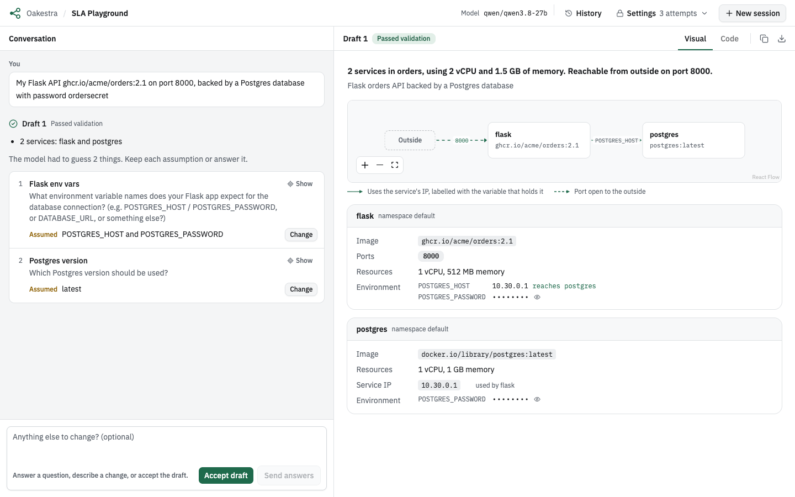
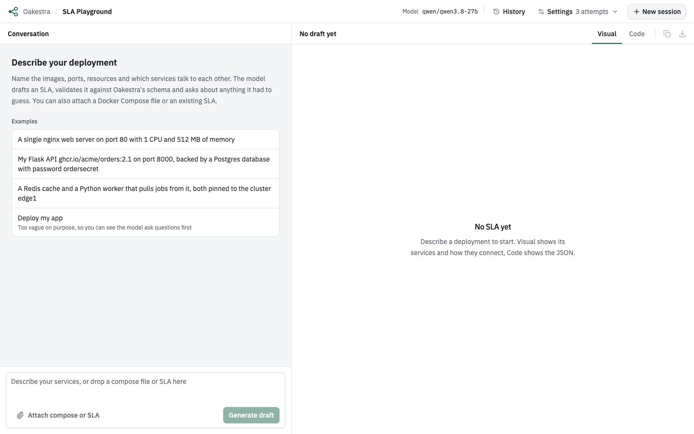
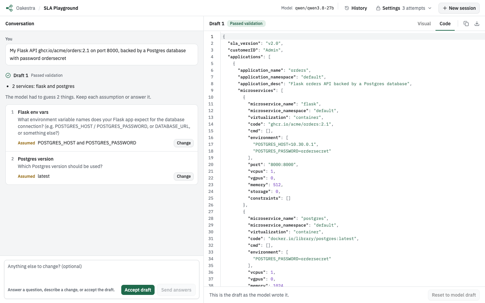
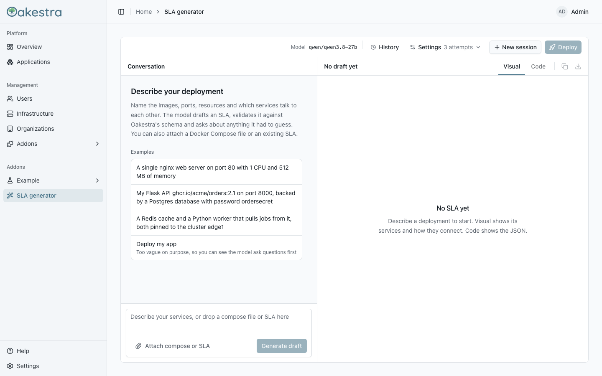
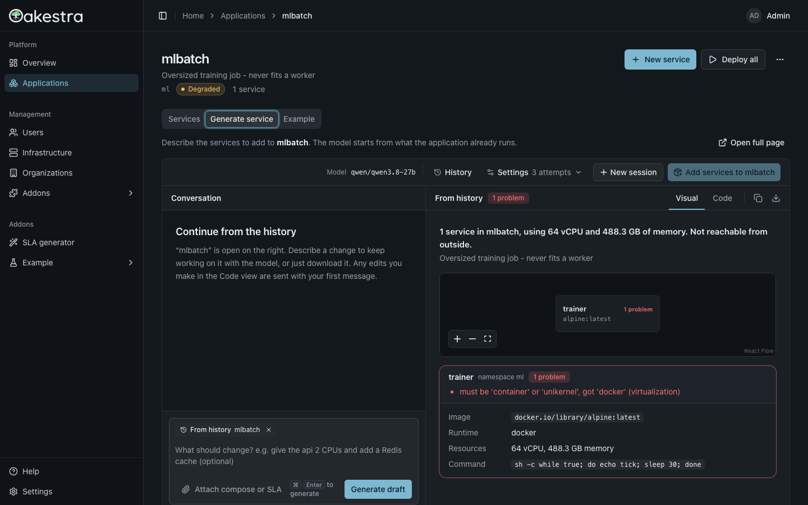

# oakestra-sla-gen

[](https://github.com/robertjndw/oakestra-sla-gen/actions/workflows/image.yml)
[](pyproject.toml)
[](https://github.com/robertjndw/oakestra-sla-gen/pkgs/container/oakestra-sla-gen)

Generate a verified [Oakestra](https://oakestra.io) SLA from a free-text description or a
Docker Compose file, or modify an existing SLA.

Oakestra deploys applications from a JSON SLA document, and writing one by hand is easy to get
wrong: strict name rules, exact field names, port syntax, units. `oakestra-sla-gen` asks an
OpenAI-compatible LLM for the SLA and **verifies it against Oakestra's own schema before
printing it**. If it can't produce a valid SLA, it fails loudly instead of handing you a broken
one.

```sh
uv run oakestra-sla-gen "a single nginx web server on port 80 with 1 cpu and 512MB memory" -o sla.json
```



## Features

- **Verified output only** - every SLA is checked against Oakestra's JSON Schema plus semantic
  checks (ports, env vars, names, resources). Validation errors are fed back to the LLM, which
  retries until the SLA passes.
- **Asks instead of guessing** - the model drafts what it can and asks about what it's unsure
  of, showing the assumption it used. Vague descriptions get questions, not invented apps.
- **Docker Compose translation** - turn an existing `compose.yaml` into an Oakestra SLA, with
  service references rewritten to Oakestra service IPs.
- **Edit existing SLAs** - start from an SLA you already have and change it in plain language.
- **Image checks** - container images are looked up in their registry, so hallucinated image
  names are caught.
- **Browser playground** - chat with the model, see the services on a map, edit the JSON by
  hand with live validation, and reopen past SLAs from the history.
- **Any OpenAI-compatible LLM** - works with local models via LM Studio as well as hosted APIs.
- **CLI, HTTP API or Oakestra addon** - use it from a terminal or a script, or deploy it next
  to your root orchestrator.
- **Dashboard UI addon** - the playground also runs inside the Oakestra dashboard, where it can
  deploy a generated SLA as a new application or add generated services to an existing one.

## Contents

- [Requirements](#requirements)
- [Quick start](#quick-start)
- [Usage](#usage)
- [Configuration](#configuration)
- [Docker Compose input](#docker-compose-input)
- [Existing SLA input](#existing-sla-input)
- [HTTP API](#http-api)
- [Playground](#playground)
- [Deployment](#deployment)
- [How it works](#how-it-works)
- [Development](#development)

## Requirements

- Python 3.12+ and [uv](https://docs.astral.sh/uv/) for the CLI and API, or Docker to run the
  API and playground without a local Python setup
- An OpenAI-compatible LLM endpoint. The defaults target a local
  [LM Studio](https://lmstudio.ai) server at `http://127.0.0.1:1234/v1` running
  `qwen/qwen3.8-27b`; see [Configuration](#configuration) to point it elsewhere.
- Node.js 24 and [pnpm](https://pnpm.io), only to work on the playground frontend

## Quick start

```sh
git clone https://github.com/robertjndw/oakestra-sla-gen.git
cd oakestra-sla-gen
uv sync

# with LM Studio serving qwen/qwen3.8-27b on port 1234
uv run oakestra-sla-gen "a single nginx web server on port 80 with 1 cpu and 512MB memory"
```

Prefer a browser? Start the [playground](#playground) with Docker, no Python needed:

```sh
docker compose up --build    # API on :8000, playground on http://localhost:8080
```

## Usage

```sh
# description as an argument, from a file, or on stdin
uv run oakestra-sla-gen "nginx on port 8080 with 1 cpu and 256MB" -o sla.json
uv run oakestra-sla-gen -f description.txt
echo "..." | uv run oakestra-sla-gen

# translate a compose file, with optional notes
uv run oakestra-sla-gen --compose compose.yaml "pin api to cluster edge1"

# change an existing SLA
uv run oakestra-sla-gen --sla sla.json "give the api 2 cpus and add a redis cache"

# check a hand-written SLA with the same verifier
uv run oakestra-sla-gen validate existing_sla.json
```

The verified SLA goes to stdout (or the `-o` file). Everything else, such as questions,
assumptions and progress, goes to stderr, so the output is safe to pipe.

`validate` prints `valid` or the list of problems it found.

### Interactive mode

When stdin and stderr are both a terminal, generation is a back-and-forth. Each round prints
a summary of the current draft and any open questions (with the assumption each one made),
then prompts for your answer. Press Enter to accept the current draft, or type `q` to abort.

```console
$ uv run oakestra-sla-gen "deploy my app"
1. [application] What should be deployed? Please describe the software or image, and how
   it should be reached (ports, protocols).
2. [dependencies] Does the app depend on any other services (databases, caches, ...)?
3. [resources] What resources does the app need (CPU, memory, storage, GPU)?
answer (Enter to accept, q to quit)> it's my flask api image ghcr.io/acme/orders:2.1 on
port 8000, needs a postgres database with password ordersecret
  api - ghcr.io/acme/orders:2.1 - port 8000:8000 - 1 vcpu / 512MB
  pg - docker.io/library/postgres:latest - 1 vcpu / 1024MB - rr_ip 10.30.0.1
1. [api env vars] What environment variable names does your image expect for the database
   connection? (assuming: DB_HOST and DB_PASSWORD)
2. [postgres database name] Does the app expect a specific database name? (assuming: default
   'postgres' database)
answer (Enter to accept, q to quit)>
{
  "sla_version": "v2.0",
  ...
}
```

### Non-interactive mode

Pass `--no-interactive` to disable the prompt. Piping stdin or redirecting stderr implies it.
The SLA is printed if there is one, and any remaining questions are listed on stderr under
"Assumptions made:". If the description was too vague to draft anything, only the questions
are printed and the command exits with `3`.

### Exit codes

| Code | Meaning |
|---|---|
| `0` | A verified SLA was printed. |
| `1` | Generation failed within the retry budget, or was aborted with `q`. Errors are on stderr. |
| `2` | Usage or connection error, or a compose file or SLA that doesn't exist or doesn't parse. |
| `3` | Non-interactive only: the description needs clarification and no SLA was produced. |

## Configuration

| Flag | Env var | Default | Description |
|---|---|---|---|
| `--base-url` | `OPENAI_BASE_URL` | `http://127.0.0.1:1234/v1` | OpenAI-compatible API endpoint |
| `--model` | `OAKESTRA_SLA_MODEL` | `qwen/qwen3.8-27b` | Model name |
| `--api-key` | `OPENAI_API_KEY` | `lm-studio` | API key |
| `--reasoning-effort` | | `low` | `low`, `medium` or `high` |
| `--timeout` | | `300` | Seconds to wait for a single LLM call. Failed calls aren't retried by the client |
| `--method` | `OAKESTRA_SLA_METHOD` | `prompt` | Structured output method: `prompt`, `json_schema` or `function_calling`. Pick what your LLM server supports |
| `--max-retries` | | `3` | Correction rounds before giving up |
| `--customer-id` | | `Admin` | Oakestra customer ID written into the SLA. With `--sla`, defaults to that file's own |
| `--no-image-check` | | off | Skip checking that images exist in their registry |
| `--no-interactive` | | off | Never prompt, see [Non-interactive mode](#non-interactive-mode) |
| `-c`, `--compose` | | | Translate a compose file, see [Docker Compose input](#docker-compose-input) |
| `-s`, `--sla` | | | Start from an existing SLA, see [Existing SLA input](#existing-sla-input) |
| `-f`, `--file` | | | Read the description from a file |
| `-o`, `--output` | | stdout | Write the SLA to a file |
| `-v`, `--verbose` | | off | Log each attempt and its errors to stderr |

For faster but less accurate results, try `--model openai/gpt-oss-20b`.

Which method to use depends on the LLM server. `prompt` works everywhere and is the safe choice
for LM Studio and other local servers, whose constrained decoding can silently drop or garble
fields. `json_schema` suits servers with reliable constrained decoding, such as
OpenAI, and `function_calling` needs a model and server that support tool calling.

## Docker Compose input

The CLI's `--compose`, the HTTP API's `compose` field and the playground's upload button all
translate a Docker Compose file into an Oakestra application, one microservice per compose
service. With `--compose`, the positional text, `-f` and stdin become optional notes alongside
the file rather than the whole description.

| Compose | Oakestra |
|---|---|
| `image` | Fully qualified `code` |
| `ports` (short or long syntax, ranges where practical) | `port` |
| `environment` (list or map, `${VAR:-default}` resolved) | `environment` |
| `command` | `cmd` |
| `deploy.resources`, `cpus`, `mem_limit` | `vcpus`, `memory` (realistic minimums if unset) |
| Service references (hostnames, connection URLs, `depends_on`, `links`) | A service IP (`addresses.rr_ip`), with every reference rewritten to it |

Compose service names don't resolve in Oakestra, which is why referenced services get a
service IP.

`volumes`, `networks`, `healthcheck`, `restart`, `secrets`, `configs` and `entrypoint` have no
Oakestra equivalent and are dropped, with a question raised when it matters. Compose files are
capped at 64,000 characters.

## Existing SLA input

The CLI's `--sla`, the HTTP API's `sla` field and the playground's upload button all start from
an SLA you already have instead of a description. The model uses it as the first draft and
leaves it alone unless told otherwise. The positional text, `-f`, stdin, the `description`
field or the playground's chat say what to change. With no notes at all, you get the same SLA
back, verified, with its images checked and any open questions raised.

The SLA doesn't have to be valid: if it fails validation, the problems are handed to the model
to fix. Fields the generator can't represent (`connectivity`, latency or geo constraints,
`bandwidth_in`, `added_files`, ...) are dropped, and the model is told which ones so it can ask
about those that change behavior. The uploaded `customerID` is kept unless you set
`--customer-id`, `customer_id` or the playground's Customer ID explicitly. SLAs are capped at
64,000 characters.

The playground tells uploads apart by content: a JSON object without a `services` key is an
SLA, anything else is a compose file. A `.json` file that doesn't parse counts as an SLA, so
you get the JSON error.

## HTTP API

The server is an optional extra, so the plain CLI install doesn't pull in FastAPI:

```sh
uv sync --extra server                 # or: pip install "oakestra-sla-gen[server]"
uv run oakestra-sla-gen serve          # http://127.0.0.1:8000, OpenAPI docs at /docs
uv run oakestra-sla-gen serve --host 0.0.0.0 --port 9000 --model openai/gpt-oss-20b
```

`serve` accepts the same `--base-url`, `--model`, `--api-key`, `--reasoning-effort`, `--timeout`
and `--method` flags (and env vars) as generation. They're fixed at startup; everything else is set
per request. A request can still override the method with its own `method` field, which is
handy for comparing methods against one server.

| Endpoint | Body | Response |
|---|---|---|
| `POST /generate` | `{"description", "compose", "sla", "method", "customer_id", "max_retries"}` | The verified SLA |
| `POST /validate` | An SLA document | `{"valid": bool, "errors": [...]}`, always `200` |

For `/generate`, one of `description`, `compose` or `sla` is required. `compose` and `sla`
take the raw file text and can't be combined. Next to either one, `description` is used as
notes. `method` is optional and defaults to the server's `--method`. `max_retries` is capped
at 10. Error responses:

- `422` with `{"kind": "generation_failed", "detail", "errors", "last_candidate"}` if no valid
  SLA came out within `max_retries`
- `422` with `{"kind": "needs_clarification", "detail", "questions"}` if the input was too vague
  to draft anything
- `422` without a `kind`, but with a readable `msg`, if the request itself is invalid, e.g.
  `compose` isn't a usable compose file or `sla` isn't usable JSON with at least one application
- `502` if the LLM server failed

Each question is `{"topic", "question", "assumption", "field"}`. `assumption` is what the
draft assumes, or `null`. `field` optionally names what the question is about, as
`<microservice_name>.<key>` with an SLA key (e.g. `redis.memory`) or just `<microservice_name>`
for a whole service. It's a hint from the model, so it can be `null` or not match the draft.

`/generate` is single-shot: it doesn't expose the interactive session, so open questions come
back once with no follow-up turn. Use the [playground](#playground) endpoints for a
conversation.

```sh
curl -X POST localhost:8000/generate -H 'content-type: application/json' \
  -d '{"description": "a single nginx web server on port 80 with 1 cpu and 512MB memory"}'
```

## Playground

The playground is a browser UI for the same draft-and-answer loop as the CLI's interactive
mode. The quickest way to run it is `docker compose up --build` and then
<http://localhost:8080> (see [Docker](#docker)). To run it from source, see
[Frontend](#frontend).



- **Conversation (left pane)** - describe your app, pick one of the examples, or upload or
  drop a compose file or an existing SLA with an optional note. Then keep changing the draft
  through the chat. While the model works, each attempt shows up as soon as it's validated,
  with the first problem if it was rejected. Each round shows whether the draft passed
  validation, what changed, and the model's open questions. Keep each assumption or answer it,
  then update or accept the draft. Hovering or focusing a question highlights the field it's
  about in the visual view, and **Show** scrolls to it. If no valid SLA comes out of a round,
  you can load the last attempt into the code view and fix it by hand.
- **Visual view (right pane)** - a map of the services, what's reachable from outside and
  which service references another's service IP, followed by a section per service with
  changed fields and validation problems marked. Values that look like secrets (passwords,
  tokens, keys) are hidden until you reveal them, and values can be copied from each row.
- **Code view (right pane)** - the editable SLA JSON, re-validated as you type. Clicking a
  problem jumps to its line. **Show changes** diffs it against the previous draft, or against
  the model's latest draft once you've edited it by hand. If the model sends a new draft while
  you have unsaved edits, you choose which one to keep.
- **Earlier drafts** - pick one from the draft menu in the right pane's header, or click its
  heading in the conversation, to see it read-only in both views. **Restore this draft** makes
  it your working copy. The model keeps refining from its latest draft either way.
- **Settings (top bar)** - attempts per round, the customer ID and whether to check that
  images exist. They lock once a session starts; **New session** unlocks them. The model and
  output method are server settings, see [HTTP API](#http-api).
- **History (top bar)** - keeps the latest draft of each session (with your hand edits) in the
  browser's local storage, up to 20 entries. Opening one starts a new session from that SLA,
  because server sessions expire after an hour. Entries can be copied, downloaded or deleted.
  Nothing leaves the browser, but any secrets in the SLAs are stored there until you delete them.

The settings, the current conversation and the width of the two panes also survive a page
reload. The UI follows the system's light or dark mode.



<details>
<summary>Playground endpoints</summary>

`serve` always includes these. The API doesn't serve any HTML; the UI is the separate
[frontend](#frontend).

| Endpoint | Description |
|---|---|
| `POST /playground/sessions` | Start a session. Same fields as `POST /generate`, plus `check_images` and `turn_id`. Returns `{session_id, sla, questions, attempts}`, or `202` with `{session_id, turn_id}` when sent with `Prefer: respond-async`. |
| `POST /playground/sessions/{id}/answer` | Continue a session with `{text, turn_id}`. Returns the same shape, also with `Prefer: respond-async`. `409` while a turn is still running. |
| `GET /playground/turns/{turn_id}` | Progress of a running turn: `{attempts}` so far (`{attempts, done: false}` for async turns). Async turns that finished return `{attempts, done: true, status, result}`, where `result` is the body the blocking request would have returned. `404` before the turn's request arrives, once a blocking turn has finished, and 15 minutes after an async turn finished. |
| `DELETE /playground/sessions/{id}` | Drop a session. |
| `GET /playground/info` | Returns `{model}`, shown in the UI header. |

`turn_id` is optional. It's a random id the client picks, 8 to 64 letters, digits, `-` or `_`,
and lets the UI poll the attempts of a turn while its request is still open. Anyone who knows
it can read the turn's errors, so don't reuse a guessable one.

Behind a proxy with a short read timeout (the Oakestra dashboard's nginx allows 60 seconds),
a turn can outlast the request. Send `Prefer: respond-async` on either POST route and the
server answers right away with `202`, `Preference-Applied: respond-async` and
`{session_id, turn_id}` (a random `turn_id` is generated if you didn't send one), then runs the
turn in the background. Poll `GET /playground/turns/{turn_id}` until `done` is `true`; `status`
is the HTTP status the blocking request would have had (`200`, `422`, `502` or `500`). Errors
found before the turn starts (invalid body, unknown session, `409`) are still returned
directly.

Sessions live only in the server process's memory. They don't survive a restart and aren't
shared across worker processes. At most 32 are kept, each for up to an hour of inactivity,
oldest evicted first.

</details>

## Deployment

### Docker

`compose.yaml` builds two images: the HTTP server with the playground API enabled (`sla-gen`,
port 8000) and the playground UI (`frontend`, port 8080).

```sh
docker compose up --build              # API on :8000, playground on http://localhost:8080
PORT=9000 FRONTEND_PORT=9080 docker compose up --build    # if the ports are taken on the host
```

Prebuilt images for amd64 and arm64 are published to `ghcr.io/robertjndw/oakestra-sla-gen`,
`ghcr.io/robertjndw/oakestra-sla-gen-frontend` and, for the
[dashboard UI addon](#dashboard-ui-addon), `ghcr.io/robertjndw/oakestra-sla-gen-addon-ui`:
`latest` from `main`, plus a version tag for each `v*` git tag.

The LLM isn't part of the container. By default it talks to LM Studio on the Docker host at
`http://host.docker.internal:1234/v1`. Set `OPENAI_BASE_URL`, `OPENAI_API_KEY`,
`OAKESTRA_SLA_MODEL` and `OAKESTRA_SLA_METHOD` in the environment (or a `.env` file) to point it
somewhere else.

> [!NOTE]
> On Linux, LM Studio has to listen on all interfaces rather than only `127.0.0.1`, or the
> container can't reach it. Docker Desktop on macOS and Windows forwards to the host's
> loopback, so it works as is.

### Oakestra addon

The server can run as an
[Oakestra addon](https://github.com/oakestra/oakestra/tree/develop/addons_engine): the root
orchestrator's addons engine runs the container next to the control plane, on the `oakestra`
Docker network. `oakestra-addon.json` is the marketplace entry for it. It defines three
services: `sla_gen` (the API, port 8000), `sla_gen_frontend` (the standalone playground UI,
port 8080) and `sla_gen_ui` (the [dashboard UI addon](#dashboard-ui-addon), no host port), plus
the `ui` block that points the dashboard at `sla_gen_ui`.

> [!IMPORTANT]
> Support for UI addons in the addons engine is new. A marketplace without it doesn't know the
> `ui` block and rejects the entry with HTTP 422 (`ui: Unknown field.`). In that case, remove
> the `ui` block and the `sla_gen_ui` service from your copy of `oakestra-addon.json` before
> registering it. The API and the standalone playground work without them.

1. **Check `environment` in `oakestra-addon.json`.** The addons engine starts the container
   with plain `docker run` options and can't add `extra_hosts`, so on Linux
   `host.docker.internal` doesn't resolve. The default, `172.17.0.1`, is the Docker bridge
   gateway on a Linux host, which reaches an LLM server on the root orchestrator host as long as
   it listens on all interfaces. Docker Desktop and OrbStack resolve `host.docker.internal` on
   their own but don't route `172.17.0.1` to the host, so there use
   `http://host.docker.internal:1234/v1`. For an LLM elsewhere, use its real address.

   The frontend's `API_UPSTREAM` must reach the API container. The addons engine names
   containers `root_<service_name>` and puts them on the `oakestra` network, so the default is
   `http://root_sla_gen:8000`. If your setup names them differently, use
   `http://172.17.0.1:8000` instead, which works because the API publishes host port 8000.
2. **Register it with the marketplace.** It moves from `under_review` to `approved` once all
   three images are pulled, so the GHCR packages have to be public (or the root orchestrator
   host has to be logged in to GHCR). One image that can't be pulled keeps the whole entry from
   being approved.

   ```sh
   curl -X POST http://<root-orchestrator>:11102/api/v1/marketplace/addons \
     -H 'content-type: application/json' -d @oakestra-addon.json
   ```

3. **Install it** using the `_id` from the previous response:

   ```sh
   curl -X POST http://<root-orchestrator>:11101/api/v1/addons \
     -H 'content-type: application/json' -d '{"marketplace_id": "<_id>"}'
   ```

The Addons pages of the [Oakestra dashboard](https://github.com/oakestra/dashboard-v2)
can do the same (register, install, disable and remove), as can the older addons dashboard on
port 11103. The addons monitor polls every 30 seconds
by default, after which the API is at `http://<root-orchestrator>:8000` and the playground at
`http://<root-orchestrator>:8080`.

In `ports`, the key is the container port and the value is the host port (the Docker SDK's
convention; the dashboard's form labels them the other way round), so change the value to move
it off 8000 or 8080.

> [!WARNING]
> Marketplace entries are stored and shown in plain text. Don't put a real API key in
> `oakestra-addon.json` on a shared setup.

### Dashboard UI addon

The playground can also run inside the
[Oakestra dashboard](https://github.com/oakestra/dashboard-v2) as a UI addon. The
dashboard downloads it at runtime and renders it in its own page, with its theme, sidebar and
login, so there is no second web app to open.



It adds:

- **An "SLA generator" page** in the sidebar's Addons group, at `/addons/sla-generator`. It is
  the full playground: conversation, service map, code view, history and settings.
- **A Deploy button** in the playground's toolbar. Once the current SLA is valid, it creates
  the application in Oakestra with the dashboard's API and your login, then opens it. Creating
  doesn't start any instances; deploy them from the application's page. The customer ID is
  always your organization, so the setting for it is hidden here.
- **A "Generate service" tab** on every application's detail page. It opens the application's
  current services in the playground, so you can describe what to add, and "Add services"
  creates only the new ones under that application. Changed or removed services are listed but
  not applied, because Oakestra can't update services in place yet. The generator allows only
  10 characters per service name where Oakestra allows 32, so the model may shorten an existing
  name. A new name with the same image and service IP as a deployed service is listed as a
  rename and not created a second time. "Open full page" continues the same conversation at
  `/addons/sla-generator/applications/<id>` (it's disabled while the model is working).

The generator never sets `arch`, which Oakestra needs for unikernel services, so Deploy and Add
services refuse a unikernel until you add it in the code view. History, settings and drafts
are kept in the browser per organization and user.



<details>
<summary>How it fits together</summary>

The addon is a [Module Federation](https://module-federation.io) remote built with the
dashboard's `@oakestra/dashboard-sdk`. It's the same source as the standalone playground in
`frontend/src`, built a second time by the package in `frontend/addon/`. The dashboard shares
React, React Router, TanStack Query and its UI library with the addon, and passes it the
current user, the Oakestra API client and its toasts. Everything else, like the theme
switching, comes from the dashboard's page itself.

The addon UI ships as its own image, `oakestra-sla-gen-addon-ui`: nginx on port 80 serving the
build. The dashboard finds it by host name, `addonui-sla-generator`, and proxies
`/addon-assets/sla-generator/*` to it. The addons monitor sets that name as a network alias on
the `oakestra` network; the container itself is still called `root_sla_gen_ui`. The addon's nginx in turn proxies
`/addon-assets/sla-generator/api/*` to the sla-gen API (`API_UPSTREAM`, default
`http://root_sla_gen:8000`), so the browser only talks to the dashboard's origin.

The dashboard's proxy gives up on a request after 60 seconds, but an LLM turn can take minutes,
so the playground starts its turns with `Prefer: respond-async` and polls for the result (see
[Playground](#playground)).

</details>

#### Deploying it

1. **Deploy the API** as described in [Oakestra addon](#oakestra-addon). The `sla_gen_ui`
   service in `oakestra-addon.json` runs the addon image next to it, and the `ui` block tells
   the dashboard to load it:

   ```json
   "ui": { "service": "sla_gen_ui", "sdk": "^0.1.0" }
   ```

   `sdk` is the range of dashboard SDK versions the addon was built against. A dashboard
   outside that range shows the addon as not compatible instead of loading it.
2. **Open the dashboard.** Once the addon is `active`, the addons manager lists it at
   `GET /api/v1/ui-addons` and the monitor gives `sla_gen_ui` the alias
   `addonui-sla-generator` on the `oakestra` network, which is where the dashboard looks for
   it. Log in and pick **SLA generator** in the sidebar.

> [!IMPORTANT]
> This needs an addons engine with UI addon support and the new
> [Oakestra dashboard](https://github.com/oakestra/dashboard-v2)
> (`ghcr.io/oakestra/dashboard-v2`) as the root orchestrator's `dashboard` service. The older
> Angular dashboard image has no `/ui-addons` or `/addon-assets/` proxy, and an older addons
> engine rejects the `ui` block. Addon UIs also don't load with `override-network-host.yml`,
> since the dashboard has no Docker DNS there to resolve `addonui-<name>`. Without those, run the
> addon with the dashboard's development stack below, whose mock addons manager does the same
> job.
>
> `/ui-addons` only lists `active` addons. If `sla_gen` or `sla_gen_frontend` fails to start,
> for example because host port 8000 or 8080 is taken, the addon is only partially active and
> the dashboard hides its UI even though `sla_gen_ui` runs.

> [!WARNING]
> `/addon-assets/` is public on the dashboard, so the sla-gen API behind it can be reached
> without logging in to the dashboard, the same as the standalone playground. The dashboard
> doesn't hand an addon the user's token to forward. If you don't want anyone who can reach the
> dashboard to use your LLM, restrict access to the dashboard at the network level.

#### Trying it with the dashboard's dev stack

You need a checkout of [the dashboard](https://github.com/oakestra/dashboard-v2) for its
development stack, and a GitHub Packages token for the addon build (see
[Developing the addon](#developing-the-addon)). The commands below assume the dashboard sits next
to this repository:

```text
Oakestra/
├── dashboard-v2/
└── oakestra-sla-gen/
```

The dashboard's `compose.dev.yml` runs the real dashboard image against a mock
system-manager and a mock addons manager. The mock doesn't start addon containers, so
`frontend/addon/compose.dashboard.yml` starts the addon UI and the sla-gen API on the
dashboard's network. Start the dashboard first:

```sh
# From the dashboard checkout
docker compose -f compose.dev.yml up --build -d

# From this repository
NODE_AUTH_TOKEN=$(gh auth token) docker compose -f frontend/addon/compose.dashboard.yml up --build -d

# Tell the mock addons manager the addon is installed and enabled
curl -X PUT http://localhost:11101/__test/addons/sla-generator \
  -H 'content-type: application/json' \
  -d '{"enabled": true, "version": "0.1.0", "sdk": "^0.1.0"}'
```

Open <http://localhost:8080>, log in as `Admin` / `Admin` and pick **SLA generator** in the
sidebar. The API uses the same LLM settings as [Docker](#docker) (`OPENAI_BASE_URL` and the
rest, LM Studio on the host by default). Port 8080 is the same one this repository's own
`compose.yaml` uses, so stop that first.

Stop the addon before the dashboard, otherwise the dashboard's `down` can't remove its network.

If the dashboard shows `Failed to get manifest` with `"<html> <h"... is not valid JSON`, the
addon containers aren't running and nginx returned a 502 page instead.

#### Developing the addon

The addon depends on `@oakestra/dashboard-sdk` and `@oakestra/ui`, which are published to
GitHub Packages, not npmjs. `frontend/addon/.npmrc` points the `@oakestra` scope there, but
GitHub Packages wants a token even for public packages, and pnpm ignores tokens in a repository's
`.npmrc`. Add a token with `read:packages` to your global pnpm config once, for example the
one from `gh`:

```sh
pnpm config set --global //npm.pkg.github.com/:_authToken "$(gh auth token)"
```

Then install the frontend, then the addon (the addon takes React from `frontend/node_modules`):

```sh
pnpm --dir frontend install
pnpm --dir frontend/addon install
```

For a fast loop, run the API, the addon's dev server and the dashboard's dev server against its
in-browser mock API:

```sh
uv run oakestra-sla-gen serve       # API on http://127.0.0.1:8000
pnpm --dir frontend/addon dev       # addon on http://localhost:5180
pnpm --dir ../dashboard-v2 dev:mock # dashboard on http://localhost:5173
```

Then open
<http://localhost:5173/?addon-override=sla-generator=http://localhost:5180/mf-manifest.json> and
log in as `Admin` / `Admin`. The override only works in the dashboard's development build. The
addon's dev server proxies `/api` to the API itself. Both dev servers want port 5173, so don't
run the standalone playground's `pnpm --dir frontend dev` at the same time.

The Vite dev proxy has no timeout, so this loop never hits the dashboard's 60-second limit.
Check long turns in the dev stack above.

Other scripts in `frontend/addon/`: `build`, `typecheck` and `test`. `build` fails if the
emitted CSS has a class without the addon's prefix (see [Frontend](#frontend)).

To build the image yourself, pass the token in as a build secret:

```sh
NODE_AUTH_TOKEN=$(gh auth token) docker buildx build \
  --secret id=node_auth_token,env=NODE_AUTH_TOKEN \
  -f frontend/addon/Dockerfile -t oakestra-sla-gen-addon-ui frontend
```

To move to a newer SDK, bump the `@oakestra/*` versions in `frontend/addon/package.json`. pnpm
holds back versions published less than a day ago; when you install one anyway it adds it to
`minimumReleaseAgeExclude` in `frontend/addon/pnpm-workspace.yaml`, so commit that file too.

The dashboard takes the addon's version from the addons manager's list, not from the build,
and offers open dashboards a reload when it changes. With the mock
that is the `version` in the `/__test` call above. The real addons manager uses the tag of the
`sla_gen_ui` image, so with `:latest` the version never changes. Pin a version tag in
`oakestra-addon.json` when you ship new addon code.

## How it works

1. A Pydantic model constrains the LLM to the subset of Oakestra's SLA that its schedulers
   actually use.
2. The output is wrapped into a full SLA and checked against Oakestra's own JSON Schema plus
   semantic checks the schema doesn't cover.
3. Any errors are fed back to the LLM, which retries up to `--max-retries` times.
4. Container images are looked up in their registry, and unusual values (very large resources,
   images the user typed that can't be found) become questions instead of errors.
5. A session wraps this into a conversation, which the CLI's interactive mode and the
   playground build on.

## Development

### Backend

```sh
uv sync
uv run ruff check
uv run ruff format
uv run pytest              # fast tests, no network
uv run pytest -m llm       # integration tests against LM Studio, skipped if unreachable
```

The code lives in `src/oakestra_sla_gen/`:

| Module | Purpose |
|---|---|
| `cli.py` | Command-line entry point |
| `generator.py` | LLM calls, retry loop and `SLASession` |
| `models.py` | Pydantic model of the SLA subset the LLM produces |
| `validation.py`, `oakestra_schema.py` | Verifier and the vendored Oakestra JSON Schema |
| `registry.py` | Container image existence checks |
| `compose.py` | Docker Compose input handling |
| `existing_sla.py` | Existing SLA input handling |
| `prompts.py` | System and correction prompts |
| `server.py`, `playground.py` | HTTP API and playground session API |

`tests/fixtures/` holds SLA fixtures vendored from Oakestra. The `sla_correct_*` ones must pass
validation and the `sla_flawed_*` ones must fail it.

### Frontend

The playground UI lives in `frontend/`: Vite, React 19, TypeScript, Tailwind, shadcn/ui,
React Flow and CodeMirror. To run it against a local API:

```sh
uv run oakestra-sla-gen serve    # API on http://127.0.0.1:8000
pnpm --dir frontend install
pnpm --dir frontend dev          # then open http://localhost:5173
```

The dev server proxies `/api` to `127.0.0.1:8000`. Other scripts, run from `frontend/` (or
with `pnpm --dir frontend`): `build`, `lint`, `typecheck` and `test`.

In production it runs as an nginx container on port 8080 that serves the build and proxies
`/api/*` to the API with the prefix stripped. The upstream is set at runtime with
`API_UPSTREAM`, so the browser only ever talks to one origin.

Every Tailwind class carries the prefix `slagen:` (`slagen:flex slagen:hover:bg-muted`),
because the same components also run inside the dashboard as the
[UI addon](#dashboard-ui-addon). There an unprefixed class could restyle the dashboard's own
markup, and the addon build refuses CSS with one. `cn()` and `components.json` know the prefix,
so `shadcn add` and class merging work as usual. A few related rules:

- Don't write global CSS. Define a class with `@utility` in `src/styles/shared.css` and use
  it with the prefix.
- Don't import third-party stylesheets into the bundle. React Flow's is injected at runtime by
  `src/components/output/xyflow-styles.ts` for this reason.
- Read Tailwind theme variables through `--theme()` rather than `var(--radius-md)`: with a
  prefix they are named `--slagen-*`.

`pnpm check:classes` lists any class that is missing the prefix. Running
`node scripts/prefix-classes.mts` without `--check` adds the prefix where it can and reports
what it left alone.

CI runs all of the checks above (except the `llm` tests) on pull requests and pushes to `main`,
checks and builds the dashboard addon against the published `@oakestra/*` packages, then
builds the three images and publishes them from `main` and `v*` tags.
